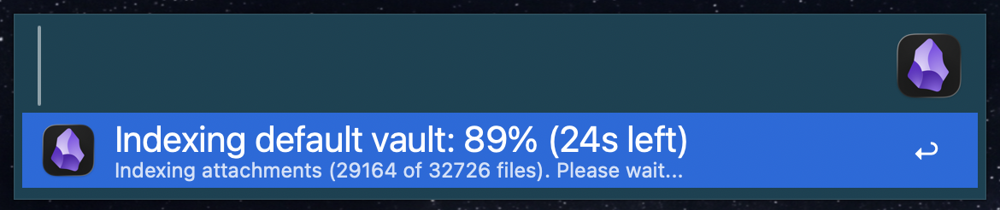
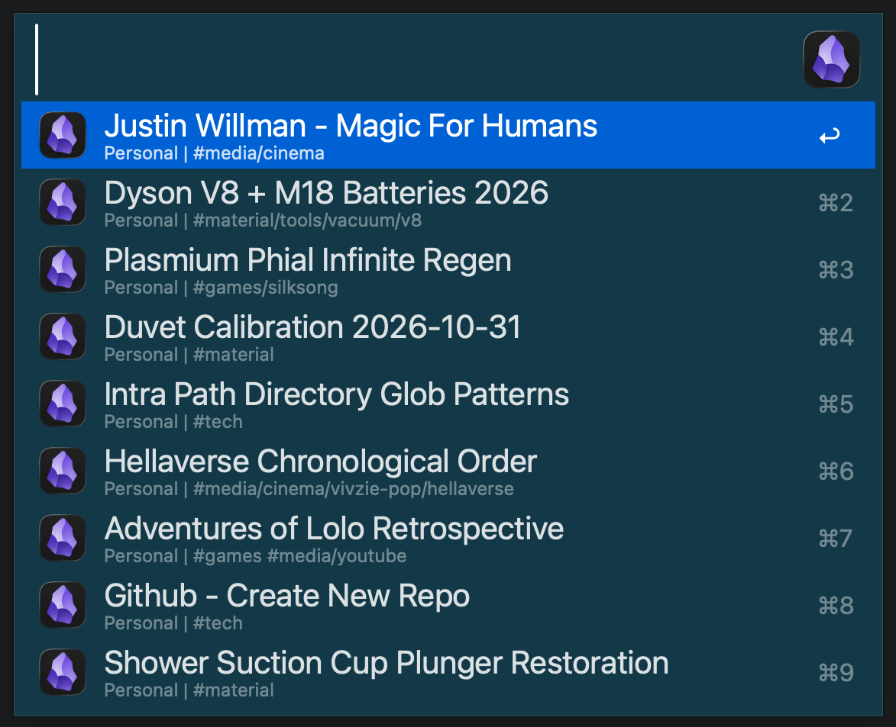
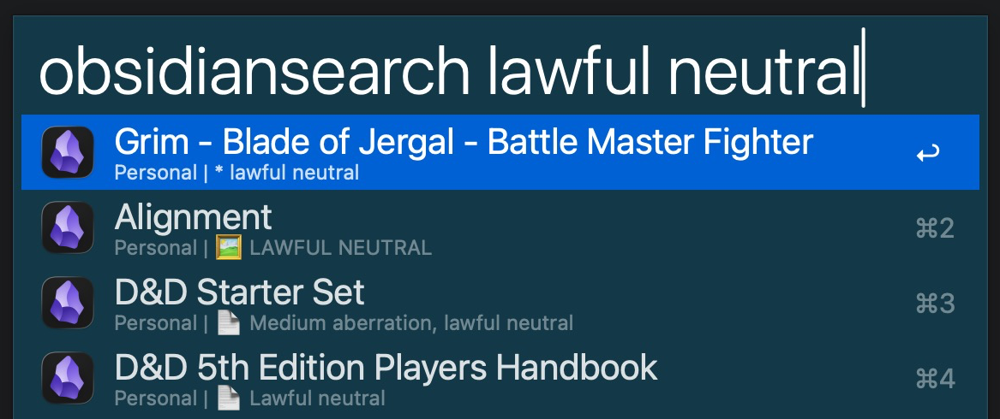
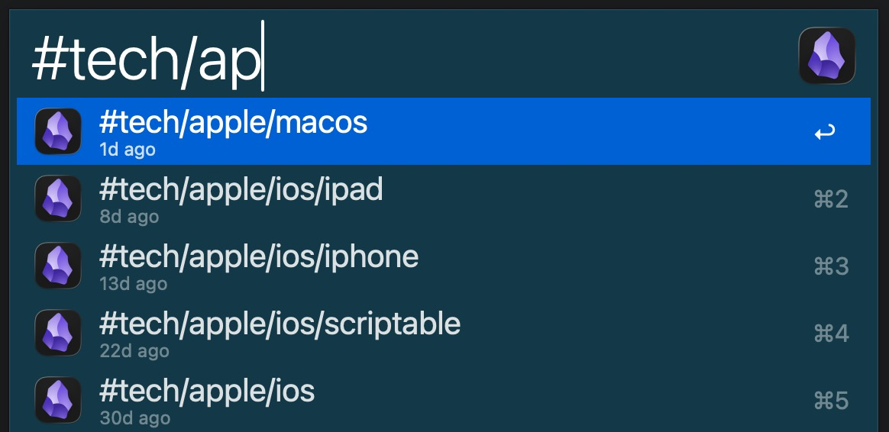
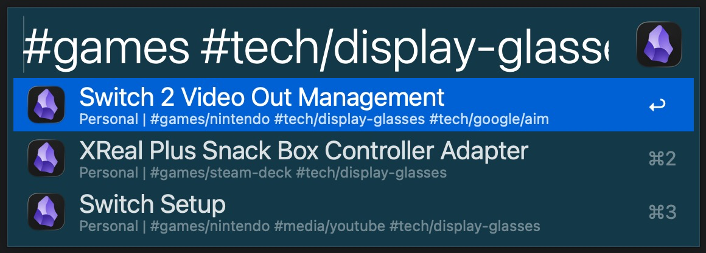
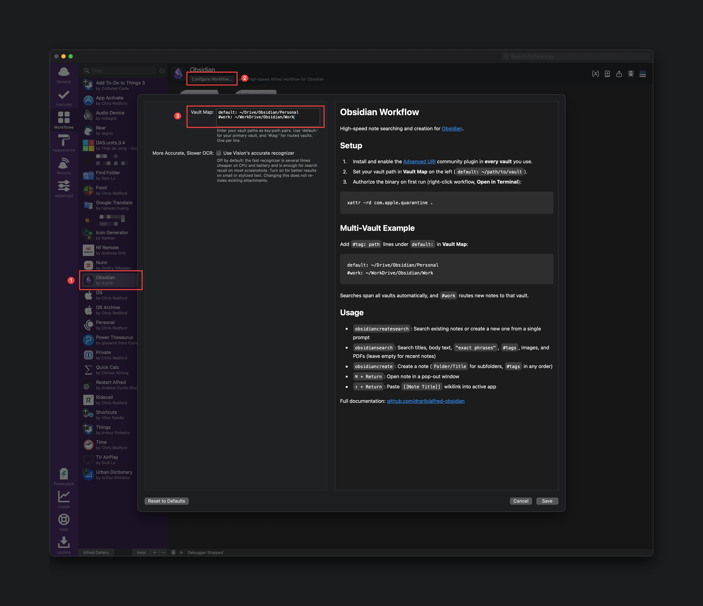
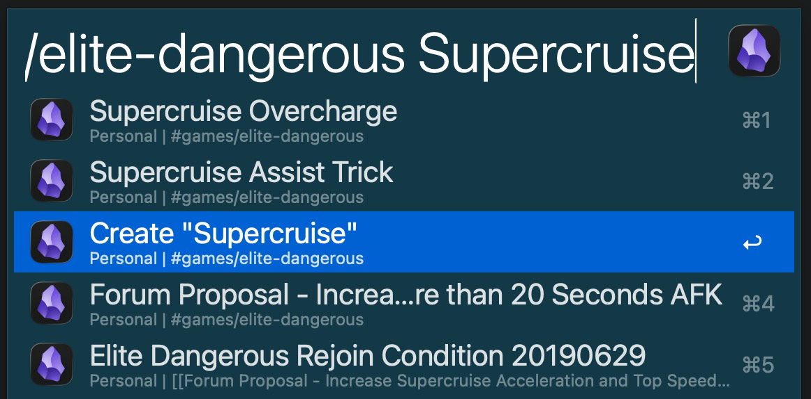
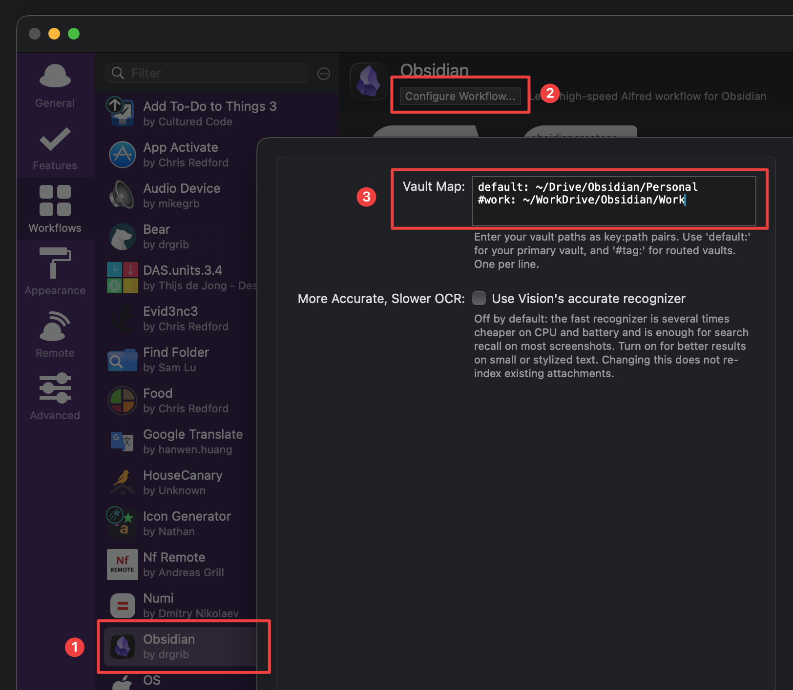

# Obsidian Workflow

Streamlined note searching and creation for [Obsidian](https://obsidian.md/) using [Alfred](https://www.alfredapp.com/). Spiritual successor to [`alfred-bear`](https://github.com/drgrib/alfred-bear).

## Install

1. Install and enable the **[Advanced URI](https://github.com/Vinzent03/obsidian-advanced-uri)** community plugin in Obsidian (**in every vault** you use).
2. Download `Obsidian.alfredworkflow` from [Releases](https://github.com/drgrib/alfred-obsidian/releases) and double-click it to install.
3. Set your vault path in **Vault Map**: `default: ~/path/to/vault` (see [Multi-Vault](#multi-vault) for multiple vaults).
4. [Authorize the executable](#authorize-executable).

## Caching

The first time you run the workflow, it indexes your vault. This process is very fast and you can even exit the workflow while it finishes in the background. As an example of how fast it is, for my 32,726-file vault (**22,350 notes, 9,848 images, and 528 PDFs**), the initial index completed in **1m 11s**. After that, day-to-day edits rapidly index incrementally every time you open the workflow, and there is no indexing after you start typing. Non-empty queries search instantly from the cache.



## Search

`obsidiansearch` (or assign a hotkey)

### Recent Notes

Leave the search empty to list your most recent notes with their folder and tags.



### Basic Search

Type to search note titles, body text, and text inside embedded images (`🖼️`) and PDFs (`📄`), prioritizing title matches.



### Tag Search

Type `#` to autocomplete tags sorted by recency. Combine multiple `#tags` and search terms in any order to narrow results.





### Open in Pop-Out Window

Hold `Command` (`⌘`) when selecting a note to open it in a separate pop-out window instead of Obsidian's main window.

### Link Pasting

Hold `Shift` (`⇧`) when selecting a note to paste a `[[Note Title]]` wikilink into your active document.


## New Notes

`obsidiancreate` (or assign a hotkey)

Type a title and optional `#tags` in any order (use `Folder/Title` for subfolders). If a note with that title already exists, it opens the existing note instead of overwriting it.



## Create/Search

`obsidiancreatesearch` (or assign a hotkey)

Searches existing notes and places a **Create** option at the third result (or at the bottom when fewer than two notes match) so you can search or create from a single prompt.



## Multi-Vault

Add `#tag: path` lines under `default:` in **Vault Map** to use multiple vaults:

```yaml
default: ~/Drive/Obsidian/Personal
#work: ~/WorkDrive/Obsidian/Work
```

Searches automatically span all configured vaults, and including `#work` when creating a note routes it to that vault.



## Authorize Executable

Because this free open-source workflow is not signed with a paid Apple Developer certificate, macOS blocks the binary on first run. To authorize it:

1. In **Alfred Preferences → Workflows**, right-click **Obsidian** and click **Open in Terminal**.
2. Run `xattr -rd com.apple.quarantine .`

#### OCR Configuration

Optional settings in **Configure Workflow...** for attachment indexing:
- **More Accurate, Slower OCR**: Uses macOS Vision's accurate recognizer instead of fast mode. To re-index existing attachments afterward, delete `~/Library/Caches/com.runningwithcrayons.Alfred/Workflow Data/com.drgrib.obsidian`.
- **OCR Workers**: Parallel OCR worker count (blank = automatic).

## Background

### Why Move from Bear to Obsidian?

Bear relies on iCloud sync (often blocked on corporate machines) and stores notes in SQLite rather than plain `.md` files that work cleanly with Git and AI agents.

### Why Not Shimmering Obsidian?

[Shimmering Obsidian](https://github.com/chrisgrieser/shimmering-obsidian) is much broader in scope and requires the third-party **Metadata Extractor** plugin (also blocked in some corporate environments), whereas `alfred-obsidian` stays minimal and indexes `.md` files directly.

### Differences from `alfred-bear`

- **Rust + local cache**: Vault scans only run on an empty query; every typed character reads strictly from cache.
- **Main window by default**: `Enter` opens notes in Obsidian's main window to avoid window clutter (`⌘` opens a pop-out window).
- **Built-in image & PDF search**: Indexes text in embedded images and PDFs locally.
- **No Table of Contents pasting**: Omitted due to low usage.

## License

[MIT](LICENSE)
