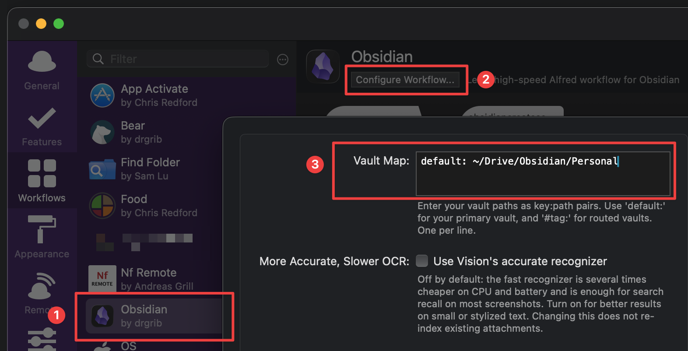
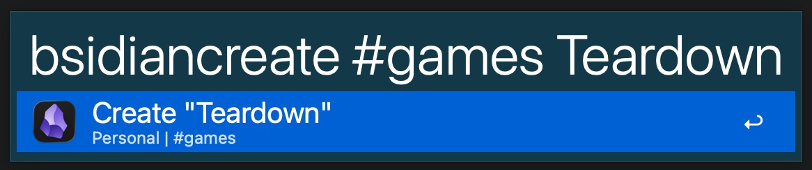
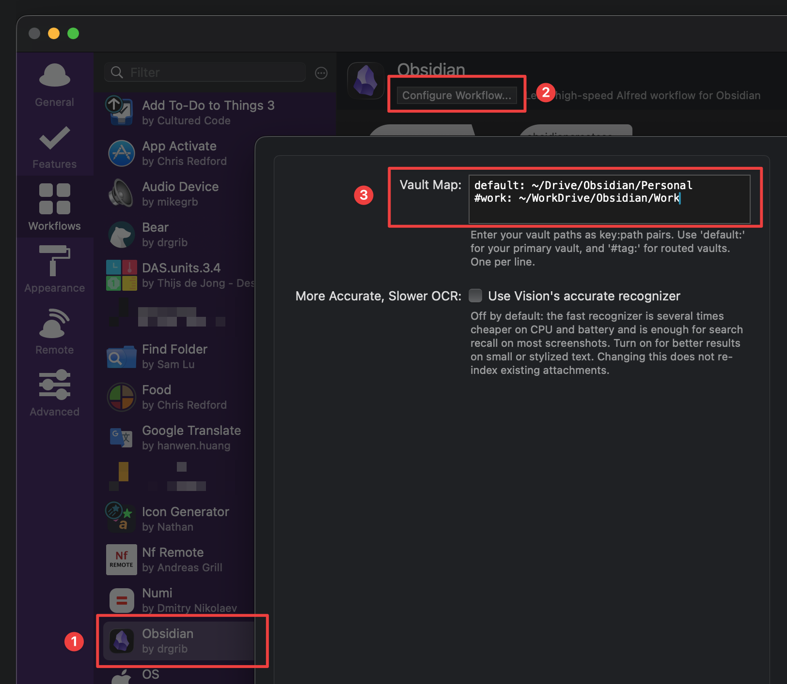
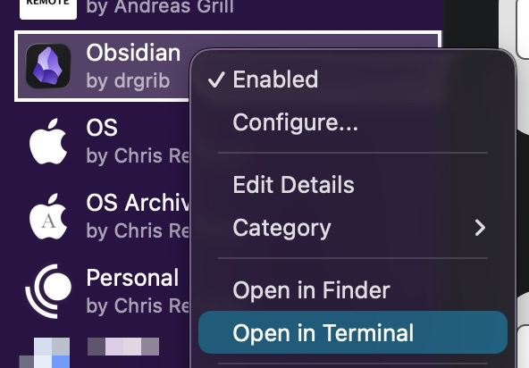
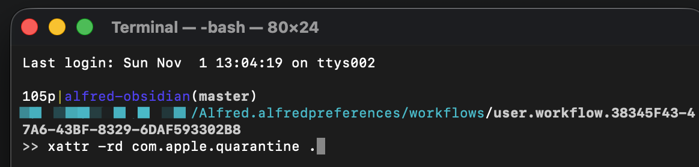

# Obsidian Workflow

High-speed note searching and creation for [Obsidian](https://obsidian.md/) using [Alfred](https://www.alfredapp.com/). Spiritual successor to [`alfred-bear`](https://github.com/drgrib/alfred-bear) with substantially improved performance and macOS Vision OCR + PDF attachment indexing.

## Install

1. Install and enable the **[Advanced URI](https://github.com/Vinzent03/obsidian-advanced-uri)** community plugin in Obsidian **in every vault** you use with the workflow.
2. Download `Obsidian.alfredworkflow` from [Releases](https://github.com/drgrib/alfred-obsidian/releases) and double-click it to install.
3. [Authorize the executable](#authorize-executable).
4. Set your vault path in **Vault Map**: `default: ~/path/to/vault` (see [Multi-Vault](#multi-vault) for multiple vaults example).



## First-Time Startup Caching

The first time you run the workflow, it indexes the vaults you added to the **Vault Map**, including running local OCR on all your images and PDFs. This process is very fast and you can even exit the workflow while it finishes in the background. As an example of how fast it is: my 32,726-file vault (**22,350 notes, 9,848 images, and 528 PDFs**) completed in **1m 11s**. After that, the workflow will rapidly update the index with any new changes every time you open the workflow. And there is no indexing once you start typing. Non-empty queries search directly and rapidly from the current cache for minimum latency.


## Hotkeys

You can assign a hotkey to any of the workflow triggers instead of typing its keyword. This has the nice side effect of directly accessing the workflow interface without the clutter of a keyword, which you will see in some of the examples below. I personally use _alt+o_ for [Create/Search](#createsearch---obsidiancreatesearch), which is the mode I recommend all users at least try for efficiency.

## Search - `obsidiansearch`

### Recent Notes

Leave the search empty to list your most recent notes with their folder and tags. This screenshot shows recent notes as accessed via hotkey by either Search or [Create/Search](#createsearch---obsidiancreatesearch), so no keyword is shown.


### Basic Search

Type to search note titles, body text, and text inside embedded images (`🖼️`) and PDFs (`📄`), prioritizing title matches.


### Tag Search

Type `#` to autocomplete tags sorted by recency.


Combine multiple `#tags` and search terms in any order to narrow results.


## New Notes - `obsidiancreate`

Type a title and optional `#tags` in any order (use `Folder/Title` for subfolders). If a note with that title already exists, it opens the existing note instead of overwriting it.



## Create/Search - `obsidiancreatesearch`

Searches existing notes and places a **Create** option as the third result, using the current text in the query for the title as well as adding the current query tags. This is the mode I use exclusively. It is the one-stop shop to initiating everything I do in Obsidian. The most critical user journey it satisfies for me is simultaneously finding a note for me if I've already created it, or immediately creating it for me if I haven't, with the fewest keystrokes.


## Link Pasting

Hold `Shift` (`⇧`) when selecting a note to paste a `[[Note Title]]` wikilink into your active document.

## Open in Pop-Out Window

Hold `Command` (`⌘`) when selecting a note to open it in a separate pop-out window instead of Obsidian's main window.

## Configuration

### Multi-Vault

Add `#tag: path` lines under `default:` in **Vault Map** to use multiple vaults. For example:

```
default: ~/Drive/Obsidian/Personal
#work: ~/WorkDrive/Obsidian/Work
```

Searches automatically span all configured vaults, and including `#work` when creating a note routes it to that vault. If you use this feature, each of your search results will be prefixed with the basename of the folder of the vault the note originates from. As you can see in my examples, my "Personal" vault is being shown as the origin. If you don't use this feature and only have one vault, there will be no such prefix.



### More Accurate, Slower OCR

Uses macOS Vision's "accurate" recognizer instead of fast mode. To re-index existing attachments afterward, delete `~/Library/Caches/com.runningwithcrayons.Alfred/Workflow Data/com.drgrib.obsidian`. You are extremely unlikely to need this but it is available if, for example, your notes have images with very small text that isn't being found.

## Authorize Executable

Because this free open-source workflow is not signed with a paid Apple Developer certificate, macOS blocks the binary on first run. To authorize it:

1. In **Alfred Preferences → Workflows**, right-click **Obsidian** and click **Open in Terminal**.
2. Run `xattr -rd com.apple.quarantine .`




## Background

### Why the Move from Bear to Obsidian?

Bear relies on iCloud sync (which was blocked by my corporate laptop) and stores notes in SQLite rather than plain `.md` files that work cleanly with Git and AI agents.

### Why Not Shimmering Obsidian?

[Shimmering Obsidian](https://github.com/chrisgrieser/shimmering-obsidian) is much broader in scope, adding a lot of elements to the user interface that I don't want. Also, frankly, the default user interface just doesn't make sense to me and doesn't interact with Obsidian in the way I find most intuitive. It also requires the third-party **Metadata Extractor** plugin (also blocked by my corporate laptop), whereas `alfred-obsidian` stays minimal and indexes `.md` files directly.

### Differences from `alfred-bear`

- **Rust + local cache**: Vault scans only run on an empty query; every typed character reads strictly from cache for significantly better performance on typed queries.
- **Main window by default**: `Enter` opens notes in Obsidian's main window due to Obsidian's cleaner and also mandatory open main window (`⌘` opens a pop-out window, but it isn't as useful or necessary as it was for me in Bear).
- **No Table of Contents pasting**: Omitted due to low usage.
